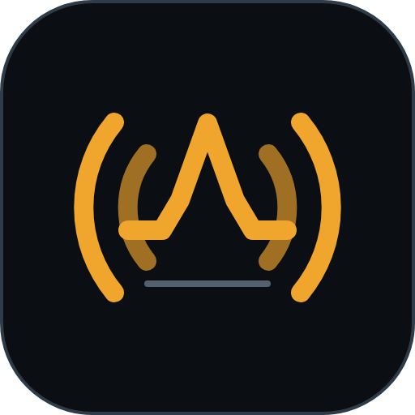
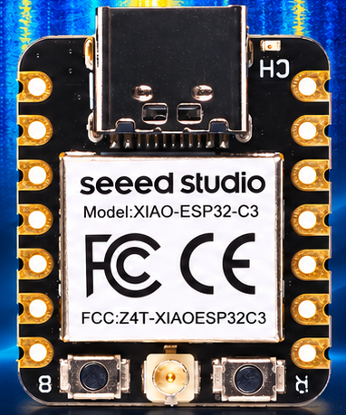

#  C3SCOPE

### The 5 EUR QO-100 spectrum viewer

**Plug. Connect. Watch.** A small web viewer for the QO-100 DATV uplink band (2401–2410 MHz), from a low-cost ESP32-C3 board. **Windows 10/11.**

The board costs about 5 EUR. You also need a 2.4 GHz antenna, and a second C3 if you want to watch your own [C3CAST](https://github.com/HB9IIU/C3CAST) signal: see [Please read before using](#please-read-before-using).

<!-- Demo video goes here, as in C3CAST: a linked thumbnail, centered. -->

<h1 align="center"><a href="https://github.com/HB9IIU/C3SCOPE/releases">&#11015; Download C3SCOPE for Windows</a></h1>

Windows 10/11 &nbsp;·&nbsp; no installation &nbsp;·&nbsp; unzip and double-click

C3SCOPE is a simple helper around the excellent **[ESP-SDR](https://github.com/ESPARGOS/esp-sdr)** receiver firmware and
**[ESP-WebSDR](https://github.com/ESPARGOS/esp-web-sdr)** viewer by **ESPARGOS**. Their work does the real job: it turns the
ESP32-C3's own Wi-Fi radio into a raw I/Q receiver and draws the spectrum in a browser. Please read their projects for how it works and its limits; this page does not repeat them.

# 🔌 PLUG &nbsp;·&nbsp; 🔗 CONNECT &nbsp;·&nbsp; 👁 WATCH

C3SCOPE only wraps it for a **Seeed Studio XIAO ESP32-C3** and for the QO-100 uplink, so that a ham can see the band without a toolchain:

1. **Plug** a second XIAO into a USB port (the native USB port, no extra adapter).
2. **Connect**: C3SCOPE finds the board by itself. A brand-new blank board can be flashed from the page.
3. **Watch**: the live spectrum and waterfall of 2401–2410 MHz appear in your browser.

by HB9IIU

## The board

The whole receiver is one **[Seeed Studio XIAO ESP32-C3](https://www.seeedstudio.com/Seeed-XIAO-ESP32C3-p-5431.html)**, a
thumb-sized board that costs about 5 EUR / USD (shop and shipping change that).

- **Chip:** ESP32-C3, RISC-V at 160 MHz, 2.4 GHz Wi-Fi and Bluetooth LE.
- **USB-C:** the chip's *native* USB. It is the only cable you need: spectra come over it and C3SCOPE flashes through it.
- **U.FL connector** (bottom centre): the RF input. Use a small 2.4 GHz antenna. Never connect a transmitter output to it.
- **B / R buttons:** boot and reset. If a board is ever not found, hold **B** while plugging it in to force download mode.

The receiving is done by the chip's own Wi-Fi radio, driven by the ESP-SDR firmware; there is no other RF hardware on the board.
Use a **separate** board for C3SCOPE: your C3CAST transmitter can stay plugged in, and C3SCOPE will tell you it needs a receiver too.

## What you get

- **Spectrum and waterfall** that share one frequency axis, cropped to **2401.000–2410.000 MHz**, with a frequency cursor and relative level.
- **QO-100 · DATV preset**: 2406 MHz centre, 16 MS/s nominal span, 2048 bins where the firmware offers them. **Reset QO-100 view** brings it back at any time.
- **Display controls**: manual RX gain, **Auto Scale** and **Auto Floor** (display levels only), averaging, pause and resume.
- **Experimental DATV hints** under the waterfall: estimated signal centre and a rounded symbol rate, for roughly 50 kS/s to 2.4 MS/s.
- **Finds the board by itself**, and finds it again when you unplug and replug it. No port picker, no browser permission prompt.
- **Guided firmware setup** for the XIAO ESP32-C3, including reinstall and erase, from the **Setup** menu. It only flashes the board you pick and confirm.
- **Runs offline**, on your own PC: no cloud account, no analytics, no Python install. Optional viewing from another PC on your LAN.

## Quick start (Windows)

No installation, no Python, no drivers to set up:

1. Download the portable package **C3SCOPE-portable.zip** from the [Releases page](https://github.com/HB9IIU/C3SCOPE/releases) and unzip it anywhere.
2. Double-click **C3SCOPE.bat**. A console window opens (close it to quit) and your browser shows the page. Windows may ask for confirmation, because the files are not code-signed.
3. Plug in the XIAO with a USB **data** cable and close any serial monitor that has its port open. C3SCOPE connects by itself.
4. If the board is blank or has no receiver firmware yet, press **Setup** in the page and let the guided setup flash it.
5. **Watch** the spectrum. Use **Reset QO-100 view** to come back to 2401–2410 MHz.

**Quit C3SCOPE** in the page header (or Ctrl-C in the console window) ends the app. Closing the last browser tab also stops it after 10 seconds.
If port 8000 is busy, C3SCOPE uses the next free one up to 8019 and prints the address in the console.

## Please read before using

- **C3SCOPE only listens.** Never connect a transmitter output directly to the C3's RF connector. If you test with a transmitter, use low power, an attenuator or a dummy load.
- **Local uplink only.** It shows RF near 2.4 GHz, not the 10 GHz satellite downlink. The window is a viewing range, not a transmission authorisation, and no signal on screen does not mean a satellite slot is free: always listen first.
- **Relative levels.** Amplitude is relative dBFS, **not calibrated dBm**. Changing gain changes what you see.
- **Snapshots with gaps.** The C3 captures snapshots, not continuous I/Q. A spike at the centre can be receiver DC/LO leakage, not a real signal.
- **DATV hints are hints.** They do not decode DVB, identify modulation or FEC, or confirm DATV. See [ETSI TR 102 376](https://www.etsi.org/deliver/etsi_tr/102300_102399/102376/01.01.01_60/tr_102376v010101p.pdf) for the background.

## Bench test with C3CAST

Run [C3CAST](https://github.com/HB9IIU/C3CAST) on one C3 (into a dummy load or attenuator) and C3SCOPE on a second one: you see your own
transmission appear and disappear in the 2401–2410 MHz window. It is a quick *"is it transmitting?"* check, not a measurement.

## Status

Version **1.0.0-beta.1** (first beta). It runs with a XIAO ESP32-C3 receiver on the author's bench: live spectrum and waterfall of 2401-2410 MHz.
The accuracy of the DATV hints and of the band edges is still being compared against known signals, and a downlink-equivalent frequency axis is not built yet.

## Notes

- **Windows 10/11** is what the portable package is built for. Python and a browser are all that is needed to run from source on other systems, but that is untested.
- **The receiver is not found:** check that the cable carries data and that no other program (serial monitor, browser flasher) has the port open.
- **"We found your ESP32 ... running DATV transmitter firmware":** that board is your C3CAST modulator. Plug in a second C3.
- **The preset says it cannot apply:** the firmware does not advertise a 16 MS/s on-chip spectrum profile. C3SCOPE then keeps the upstream defaults and tells you why.
- Running from source, the LAN mode, tests and how to build the zip are in [DEVELOPMENT.md](DEVELOPMENT.md). Provenance and protocol notes are in [BASELINE.md](BASELINE.md).

## Credits and licence

- **ESP-SDR firmware and ESP-WebSDR viewer: ESPARGOS** ([esp-sdr](https://github.com/ESPARGOS/esp-sdr), [esp-web-sdr](https://github.com/ESPARGOS/esp-web-sdr)), by Florian Euchner and Zoltan Doczi. The on-chip spectrum mode was contributed by [z2labs.io](https://www.z2labs.io). All the clever part is their work. This is an independent adaptation; no ESPARGOS endorsement is implied.

**Licence: GPL-3.0-or-later for the viewer** (`viewer/`, a clone of ESP-WebSDR; see [viewer/LICENSE](viewer/LICENSE)). Its original history and third-party notices
(`viewer/flasher/vendor/`, `viewer/fonts.css`) are kept unchanged. The [ESP-SDR firmware](https://github.com/ESPARGOS/esp-sdr) is licensed separately.
A licence for the Python launcher in this folder has not been chosen yet.

The portable package bundles the official embeddable **Python** (PSF licence), plus Flask, pyserial and esptool, each under its own licence.

73 de HB9IIU
