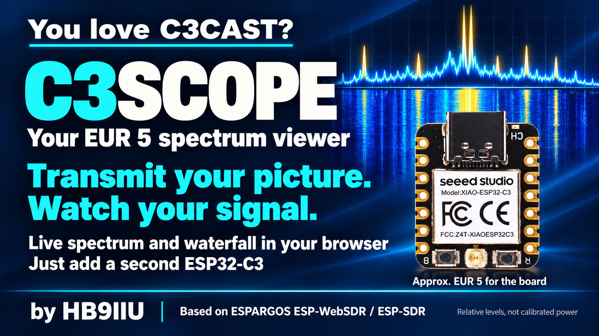

# C3SCOPE: a 5 EUR QO-100 spectrum viewer



**See your signal.**

C3SCOPE is a local web spectrum and waterfall viewer for the **QO-100 DATV uplink band (2401–2410 MHz)**. It runs on a second **Seeed Studio XIAO ESP32-C3** board (about 5 EUR) that acts as a receive-only SDR. It is built on the ESP-SDR firmware and ESP-WebSDR viewer by [ESPARGOS](https://espargos.net/).

It is the companion to [C3CAST](https://github.com/HB9IIU/C3CAST): transmit your picture with one C3, watch your signal with another.

**Plug. Connect. Watch.**

## What you need

- A **Seeed Studio XIAO ESP32-C3** (native USB-C) flashed with ESP-SDR receiver firmware. About 5 EUR.
- A USB **data** cable (not a charge-only cable).
- A Windows 10/11 PC and a browser. Chrome or Edge is recommended.
- A 2.4 GHz antenna on the board's U.FL connector.

No cloud account, no analytics, no Python install and no installer. Everything runs on your own PC.

> Use a **separate** board for C3SCOPE. A C3 that is running C3CAST transmitter firmware can stay plugged in, and C3SCOPE will tell you it needs a receiver too.

## Quick start

1. Download **C3SCOPE-portable.zip** from the [Releases](https://github.com/HB9IIU/C3SCOPE/releases) page and unzip it anywhere.
2. Plug in the receiver C3 with a USB data cable and close any serial monitor that has its port open.
3. Double-click **C3SCOPE.bat**. A console window opens and shows the address. Windows may ask for confirmation, because the files are not code-signed. Python is bundled, so you install nothing.
4. Your browser opens at `http://127.0.0.1:8000`. If that port is busy, C3SCOPE uses the next free one up to 8019 and prints the address in the terminal.
5. The receiver is **detected and connected automatically**. There is no port picker and no browser serial permission prompt.
6. If the board is blank or has no receiver firmware yet, use the guided setup in the page to flash it.

Stop the app with **Quit C3SCOPE** in the header or with Ctrl-C in the console window. Closing the last browser tab also stops it after a 10-second grace period.

### Run from source

```sh
python -m pip install -r requirements.txt
python app.py
```

### Build the portable zip

```powershell
powershell -File build_portable.ps1
```

This downloads the official embeddable Python, installs the requirements into it, and writes `dist\C3SCOPE-portable.zip`. It deliberately does not build an exe with PyInstaller, because unsigned PyInstaller exes are often flagged by Windows Defender. The bundled Python also carries esptool for the guided firmware setup.

## Features

### Access from another PC on your LAN

Start the host PC with the ESP connected:

```sh
python app.py --lan --no-browser
```

Open the **LAN viewer** URL printed in the terminal on the other PC, for example
`http://192.168.1.50:8000`. The selected port may differ if 8000 is occupied.
Only one tab controls the receiver at a time: close an existing viewer before
opening it elsewhere. `--lan` keeps the host running after tabs close. Stop it
with Ctrl-C, or use **Quit C3SCOPE** at the host's `http://127.0.0.1:PORT` address.
Firmware installation, erasing and quitting are blocked for remote PCs.
Use this mode on your trusted LAN. If Windows asks, allow access on your private
network; the host firewall must allow the chosen port. No router port forwarding
is needed. Without `--lan`, the existing local-only automatic shutdown remains.
C3SCOPE runs as a single instance: starting it again reuses the existing app
instead of launching another scanner. To switch a running local app into LAN
mode, quit it first, then start it with `--lan`.

### Viewer features

- Live **spectrum and waterfall** that share one frequency axis, cropped to **2401.000–2410.000 MHz**.
- **QO-100 · DATV preset**: 2406 MHz centre, 16 MS/s nominal span, 2048 bins where the firmware offers them. **Reset QO-100 view** brings it back at any time.
- Frequency cursor with relative level.
- Manual RX gain, **Auto Scale** and **Auto Floor**. These change the display levels only.
- Pause and resume, and averaging.
- **Experimental DATV hints** under the waterfall: estimated signal centre and a rounded symbol rate, for roughly 50 kS/s to 2.4 MS/s.
- Automatic rediscovery when you unplug and replug the receiver.
- Guided firmware setup for the XIAO ESP32-C3.
- Receiver firmware updates use the same guided installer. **Setup → Reinstall
  receiver firmware…** is also available for recovery, even without an update.
  Reviewing or cancelling leaves reception running; confirming pauses reception,
  erases the selected board, installs and verifies the bundled firmware, and
  reconnects automatically. Settings and files on the PC are not erased.
- **Setup → Erase ESP32…** completely erases the selected XIAO after explicit
  confirmation and leaves it blank. It does not install replacement firmware;
  use guided setup afterward to make it a C3SCOPE receiver again.

## How it works

```
XIAO ESP32-C3 (ESP-SDR)  <--USB-->  Python / Flask (pyserial)  <--WebSocket-->  browser
```

The firmware captures the 2.4 GHz band and sends processed FFT spectra. The Python app owns the serial port, probes for a confirmed ESP-SDR receiver, and passes the data to the page over a local WebSocket. One viewer tab controls the receiver at a time.

## Good to know

- **Local uplink only.** C3SCOPE shows RF near 2.4 GHz. It does not receive the 10 GHz satellite downlink. A downlink-equivalent label would only add 8089.500 MHz to the uplink frequency, and it would not be evidence of satellite reception or of a free slot. That label is not built yet.
- **Relative levels.** Amplitude is relative dBFS, not calibrated dBm. Changing gain changes what you see.
- **Snapshots with gaps.** The C3 captures snapshots, not continuous I/Q. A centre spike can be receiver DC/LO leakage, not a real signal.
- **DATV hints are hints.** They do not decode DVB, identify modulation or FEC, or confirm DATV. No hint does not mean a frequency is clear. See [ETSI TR 102 376](https://www.etsi.org/deliver/etsi_tr/102300_102399/102376/01.01.01_60/tr_102376v010101p.pdf) for the background.
- **No transmit controls.** C3SCOPE is receive-only.

## Troubleshooting

**The receiver is not found:** check that the cable carries data and that no other program, such as a serial monitor or the browser flasher, has the port open.

**"We found your ESP32 ... running DATV transmitter firmware":** that board is your C3CAST modulator. Plug in a second C3 with receiver firmware.

**The board is blank or unrecognised:** use the guided setup, which supports the XIAO ESP32-C3 only.

**Flashing with the browser installer:** stop the Flask app first so the serial port is free.

**The preset says it cannot apply:** the firmware does not advertise a 16 MS/s on-chip spectrum profile. C3SCOPE then keeps the upstream defaults and tells you why.

## Status

Version: pre-release, work in progress.

Done: baseline inspection, branding, QO-100 preset and crop, and automatic USB discovery. The automated checks pass.

Run them with Node.js (used only for tests):

```sh
node --test viewer/tests/*.test.mjs
python -m unittest
```

**Not yet verified in a browser or with real hardware:** the preset, the crop edges, RF orientation and the DATV hints still need checking against known signals. Outstanding: downlink-equivalent axis, receiver frame-rate and stale-data display, and saved preferences. See [BASELINE.md](BASELINE.md) for the evidence and protocol notes, and [DEVELOPMENT_NOTES.md](DEVELOPMENT_NOTES.md) for developer detail.

## Safety and legal

C3SCOPE only listens. Never connect a transmitter output directly to the C3's RF connector. If you test with a transmitter, use low power, an attenuator or a dummy load. The uplink window shown is a viewing range, not a transmission authorisation and not a measurement of satellite occupancy.

## Credits

- **ESPARGOS**: [ESP-SDR firmware](https://github.com/ESPARGOS/esp-sdr) and [ESP-WebSDR viewer](https://github.com/ESPARGOS/esp-web-sdr), by Florian Euchner and Zoltan Doczi. The on-chip spectrum mode was contributed by [z2labs.io](https://www.z2labs.io).
- **SP8ESA**: ESP32-DATV, the base of C3CAST.

This is an independent adaptation, and no ESPARGOS endorsement is implied.

73 de **HB9IIU**

## License

The viewer in `viewer/` is a clone of ESP-WebSDR, licensed under the GNU General Public License, version 3 or later (`GPL-3.0-or-later`); see [viewer/LICENSE](viewer/LICENSE). Its original history and third-party notices (`viewer/flasher/vendor/`, `viewer/fonts.css`) are kept unchanged. The [ESP-SDR firmware](https://github.com/ESPARGOS/esp-sdr) is licensed separately. A licence for the Python launcher in this folder has not been chosen yet.
